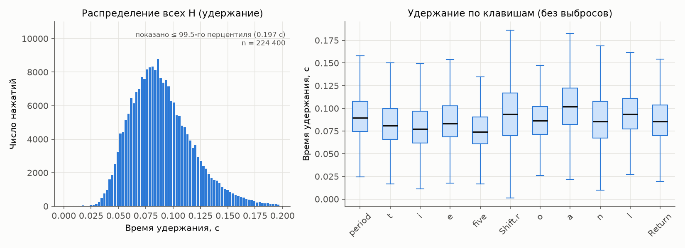
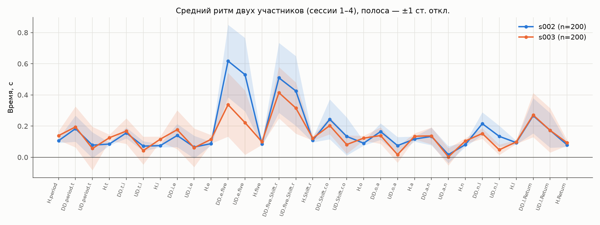
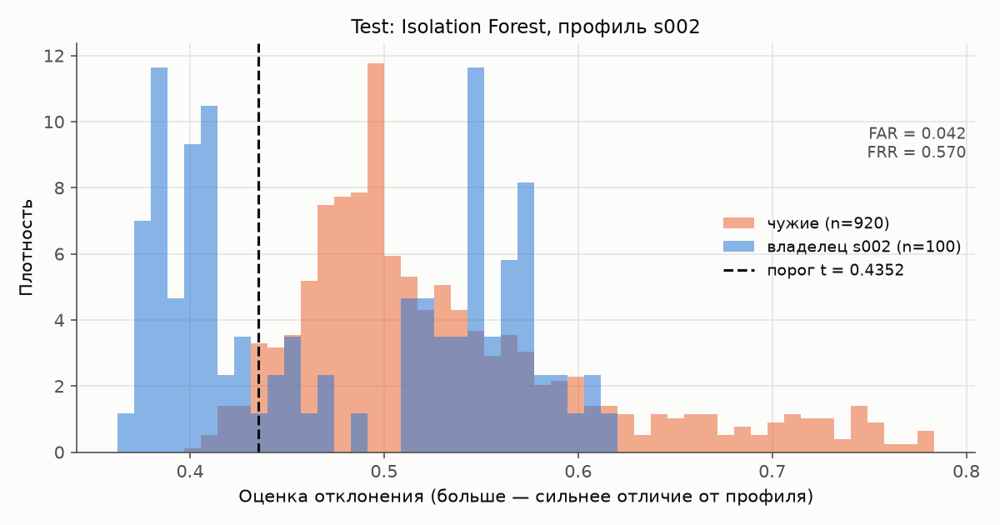

# Клавиатурный почерк: отчёт

Вопрос: можно ли отличить владельца профиля от другого человека, если оба вводят одну и ту же последовательность символов. Все числа взяты из файлов, которые генерируют скрипты (`reports/*.csv`, `reports/*.md`, `config/frozen.json`); команды воспроизведения — в README.

## 1. Данные

CMU Keystroke Dynamics Benchmark (Killourhy, Maxion, DSN 2009): 51 участник × 8 сессий × 50 вводов пароля `.tie5Roanl` + Enter, 20 400 строк, файл сверяется по SHA-256. Признаки — 31 временной столбец в секундах: 11 `H` (удержание), 10 `DD` (keydown→keydown), 10 `UD` (keyup→keydown); `subject`, `sessionIndex`, `rep` используются только для отбора строк.

По `reports/eda_summary.md`: пропусков и дубликатов нет, у каждого участника по 50 вводов в каждой сессии. Медиана удержания 0.086 с, медиана `DD` 0.191 с. Отрицательных `UD` 10.84 % (хотя бы одно — в 54 % строк; больше всего у пары `a→n`, 31.8 %) — это перекрытие нажатий, значения сохраняются. Тождество `UD = DD − H` выполняется для 100 % строк.

## 2. Протокол

Владельцы — первые 5 идентификаторов после сортировки: s002, s003, s004, s005, s007. Остальные 46 участников разделены поочерёдно на пулы validation и test по 23 человека, одинаково для всех владельцев.

| Выборка | Источник | Размер |
|---|---|---|
| train | владелец, сессии 1–4 | 200 |
| validation | владелец, сессии 5–6 / пул validation, повторения 1–5 всех 8 сессий | 100 / 920 |
| test | владелец, сессии 7–8 / пул test, повторения 1–5 всех 8 сессий | 100 / 920 |

Защита от утечки встроена в код. Масштабирование обучается только на train. `scripts/tune.py` строит выборки без test-ролей, пишет `config/frozen.json` и отказывается работать без чистого git-коммита. Пороги и параметры закоммичены (`75dfc2b`) до первого запуска `scripts/evaluate.py`. Скрипт оценки ничего не подбирает: он переобучает модели с замороженными параметрами, проверяет побитное совпадение validation-FAR/FRR с `frozen.json` и только затем считает test.

**Отличие от статьи CMU.** В статье владельцем по очереди был каждый из 51 участника. Детектор (сравнивалось 14 детекторов) обучался на первых 200 вводах владельца и тестировался на остальных 200 его вводах и на первых 5 вводах каждого из 50 других участников. Отдельной validation-выборки с фиксацией порога не было, а метрики — equal-error rate и zero-miss FAR. Здесь — 5 владельцев, разделение по сессиям, отложенная validation и метрика (FAR+FRR)/2 при фиксированном пороге, поэтому числа с опубликованными не сравниваются.

## 3. Методы и выбор порога

Оба метода используют одно масштабирование по train (`std` с ddof=0, признак с `std < 1e-12` получает `std = 1`); больше оценка — сильнее отклонение.

- **MeanAbs** (базовый): `score = mean_j |z_j − mu_j|`, `mu` — средний вектор владельца.
- **Isolation Forest**: `score = −score_samples(z)`, `random_state = 42`; `contamination` на оценки не влияет, решение принимает собственный порог.

Порог: принять, если `score ≤ t`; кандидаты — все validation-оценки и «отклонить всех»; минимум (FAR+FRR)/2, при равенстве меньший FAR, затем меньший `t`. Правило одно для обоих методов.

Одна конфигурация Isolation Forest на всех владельцев выбирается по средней validation-ошибке (`reports/validation_metrics.csv`):

| n_estimators | max_samples | max_features | (FAR+FRR)/2 |
|---|---|---|---|
| 100 | auto | 1.0 | 0.1561 |
| **100** | **auto** | **0.5** | **0.1273** |
| 100 | 64 | 1.0 | 0.1571 |
| 100 | 64 | 0.5 | 0.1318 |
| 300 | auto | 1.0 | 0.1420 |
| 300 | auto | 0.5 | 0.1314 |
| 300 | 64 | 1.0 | 0.1317 |
| 300 | 64 | 0.5 | 0.1283 |
| MeanAbs | — | — | 0.1420 |

При 200 строках train `max_samples='auto'` равно 200, то есть подвыборки нет. Варианты с `max_features = 0.5` лучше во всех четырёх парах. Для приложения по validation выбран Isolation Forest (0.1273 против 0.1420). Validation-метрики оптимистичны: порог и конфигурация подбирались на них же.

## 4. Результаты на test

`reports/metrics.csv`; у каждого владельца 200 вводов train, 100 своих и 920 чужих вводов test.

| Владелец | Порог MeanAbs | FAR | FRR | Ошибка | Порог IF | FAR | FRR | Ошибка |
|---|---|---|---|---|---|---|---|---|
| s002 | 0.9133 | 0.0696 | 0.550 | 0.3098 | 0.4352 | 0.0424 | 0.570 | 0.3062 |
| s003 | 0.8921 | 0.0402 | 0.890 | 0.4651 | 0.4395 | 0.0424 | 0.720 | 0.3812 |
| s004 | 0.9099 | 0.0815 | 0.130 | 0.1058 | 0.4296 | 0.0565 | 0.150 | 0.1033 |
| s005 | 0.8938 | 0.0261 | 0.110 | 0.0680 | 0.4344 | 0.0207 | 0.160 | 0.0903 |
| s007 | 1.2405 | 0.4087 | 0.100 | 0.2543 | 0.5127 | 0.3826 | 0.040 | 0.2113 |
| **Среднее** | | **0.1252** | **0.356** | **0.2406** | | **0.1089** | **0.328** | **0.2185** |

Isolation Forest в среднем лучше (0.2185 против 0.2406): заметно у s003 и s007, на 0.002–0.004 у s002 и s004; хуже у s005 (0.0903 против 0.0680, рост FRR с 0.11 до 0.16). Разница между владельцами больше разницы между методами. Средняя ошибка на test выше validation (0.13–0.14), и около 90 % прироста FRR дают s002 и s003.

Профиль для графика выбран до просмотра test (первый владелец). Оценки вводов s002 распадаются на два кластера: часть лежит левее порога, часть смещена вправо и перекрывается с чужими. График для MeanAbs — `figures/score_distribution_s002_mean_abs_distance.png`.

## 5. Анализ ошибок

`reports/error_analysis.md`; 18 разобранных случаев — `reports/error_cases.csv` (по 3 ложных принятия, ложных отказа и пограничных на метод, топ-5 признаков по |z − mu| со знаком).

1. **MeanAbs, s002, сессия 7, ввод 42 — ложный отказ.** Отклонения по многим признакам: крупнейшее — пауза между `t` и `i` (`UD.t.i` +11.3σ, `DD.t.i` +10.0σ), а также `H.period` −6.8σ, `H.i` +6.4σ. Оценка выше порога и без пары `t→i`.
2. **Isolation Forest, s002, сессия 8, ввод 42 — ложный отказ.** Удержания намного длиннее профиля: `H.Return` +8.9σ, `H.five` +6.0σ, `H.n` +5.9σ.
3. **MeanAbs, профиль s007, чужой s026, сессия 1, ввод 5 — ложное принятие.** Выраженные отличия в двух признаках (`H.n` −3.4σ, `UD.n.l` +2.4σ), но среднее по 31 признаку остаётся ниже высокого порога s007.
4. **Isolation Forest, профиль s007, чужой s051, сессия 6, ввод 4 — ложное принятие.** Умеренные отклонения одного знака (−1.5…−2σ: `H.e`, `DD.o.a`, `UD.o.a`) — ввод быстрее профиля, но в пределах его разброса.
5. **Isolation Forest, s003, сессия 8, ввод 26 — пограничный отказ владельца** (выше порога на 1.2·10⁻⁵), главное отклонение `H.e` +4.3σ.
6. **MeanAbs, профиль s002, чужой s010, сессия 1, ввод 4 — пограничный отказ** (запас 2·10⁻⁴) по удержаниям `H.a` −3.4σ, `H.Shift.r` −2.8σ.

Наблюдения по всей test-выборке:

- **Ложные отказы сосредоточены по сессиям.** У s002 FRR 0.12–0.14 в сессии 7 и 0.98–1.00 в сессии 8; у s003 обе сессии отклоняются на 68–90 %. В отклонённых вводах s002 удержания в среднем на +2.5σ длиннее профиля. Это согласуется с изменением манеры набора между сессиями 1–4 и 7–8; чаще всего в топ-5 при ложных отказах попадают удержания `H.e`, `H.i`, `H.period`, `H.o`.
- **Ложные принятия сосредоточены у профиля s007** (FAR около 0.4 у обоих методов; порог s007 выше остальных), чаще всего выделяются `H.n`, `H.a`, `UD.n.l`. По чужим ошибки распределены широко: 22 из 23 участников (MeanAbs) и 20 из 23 (Isolation Forest), на трёх самых частых — 30–31 %.
- **Гипотезы о разнице методов** (не проверялись отдельно). MeanAbs усредняет отклонения по всем признакам, и выраженные отличия чужого в 2–3 признаках могут теряться — случай 3. Isolation Forest с `max_features = 0.5` строит разбиения по подмножествам признаков и, вероятно, чувствительнее к таким комбинациям. Проигрыш у s005 — у владельца с самой низкой ошибкой — может объясняться тем, что оценки леса лежат в узком диапазоне (пороги 0.43–0.51), и небольшой сдвиг манеры переводит заметную долю вводов через порог; на 5 профилях это не проверить.

## 6. Приложение

FastAPI на 127.0.0.1 и одна страница на HTML/CSS/JS. Браузер записывает `keydown`/`keyup` только в поле ввода и сразу отклоняет попытку при исправлении, вставке, автоповторе, модификаторах, стрелках, клике мышью, потере фокуса, неверном символе или раскладке. Сервер повторно проверяет события и сам считает 37 признаков фразы `typing rhythm` (13 `H`, 12 `DD`, 12 `UD`, секунды, порядок как в CMU). Профиль CMU к этой фразе не применяется: модель обучается на 30 собственных вводах методом и параметрами из `frozen.json → app_method`, порог — 95-й перцентиль (линейная интерполяция) оценок на 10 отложенных вводах. Модель, схема признаков, порог и средний ритм сохраняются в `profiles/active/` и загружаются после перезапуска. Время событий берётся из `performance.now()` в обработчике, поэтому задержки главного потока браузера добавляют миллисекундный шум.

**Ограничение порога.** Он построен по 10 вводам владельца и ничего не говорит о FAR для других людей. При линейной интерполяции 95-й перцентиль из 10 значений лежит между двумя наибольшими оценками; если манера не меняется, новый ввод владельца превышает их с вероятностью от 1/11 до 2/11 — ожидаемый FRR около 9–18 %, а не 5 %. Оценка отклонения — не вероятность и не уверенность.

## 7. Собственный эксперимент

Профиль создан в приложении (Windows 11 Pro, Chrome 157, физическая клавиатура): Isolation Forest, порог 0.4391 (калибровочные оценки 0.401–0.441). После фиксации профиля — три серии по 10 новых корректных вводов на той же клавиатуре и в том же браузере; профиль и порог не менялись. Источник — `reports/own_experiment.csv`.

| Серия | n | Средняя длительность, с | Средняя оценка | Принято | Отклонено |
|---|---|---|---|---|---|
| Обычный набор | 10 | 3.98 | 0.4437 | 5 | 5 |
| Замедленный набор | 10 | 4.92 | 0.4684 | 3 | 7 |
| С паузой ~1 с между словами | 10 | 5.27 | 0.4608 | 2 | 8 |

Замедление удлинило ввод на 24 %, пауза — на 33 %; в обоих случаях средняя оценка выросла, а доля принятых снизилась. Но уже обычный набор принят только в 5 из 10 попыток при средней оценке выше порога — больше ожидаемых 9–18 % отказов. Вводы эксперимента набирались после 40 вводов сбора, и это согласуется с наблюдением на CMU: манера смещается со временем, а порог по 10 вводам к этому неустойчив. Различия между сериями малы относительно выборки: точный тест Фишера для доли принятых даёт p ≈ 0.65 (замедленный против обычного) и p ≈ 0.35 (с паузой против обычного). Эксперимент демонстрационный; количественная оценка — на CMU.

**Как отделить общую скорость от рисунка ритма.** В текущих признаках темп и рисунок смешаны: при замедлении растут все `DD` и `UD`. Нужно:

- нормировать интервалы на длительность попытки и сравнивать только форму ритма;
- сравнить оценки по одним удержаниям `H`, слабее зависящим от темпа;
- добавить серию «быстрее обычного»;
- для серии с паузой исключить пару на стыке слов;
- повторить обычную серию в другое время и с большим числом попыток, чтобы отделить манеру от дрейфа и шума порога.

## 8. Выводы и ограничения

- На пяти профилях CMU оба метода отличают владельца от чужих лучше случайного, но с большой разницей между людьми: средняя ошибка на test 0.2406 (MeanAbs) и 0.2185 (Isolation Forest). Выигрыш Isolation Forest невелик и получен на 5 профилях.
- Ошибки в основном связаны с ложными отказами у двух владельцев и согласуются с изменением манеры между сессиями; порог, выбранный на сессиях 5–6, этого не учитывает. Собственный эксперимент показывает ту же картину в малом масштабе.
- Validation-метрики оптимистичны; test опирается на 5 владельцев и 23 чужих участника.
- Прототип учебный: порог приложения основан на 10 вводах, профиль не обновляется со временем, нет защиты от целенаправленной имитации; результат не подтверждает пригодность метода для контроля доступа.
